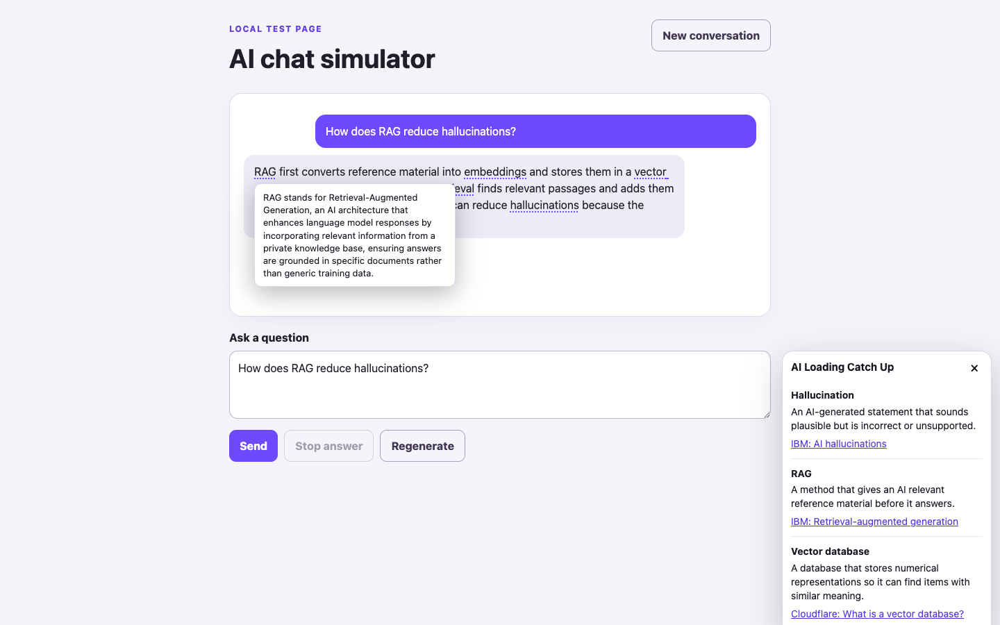
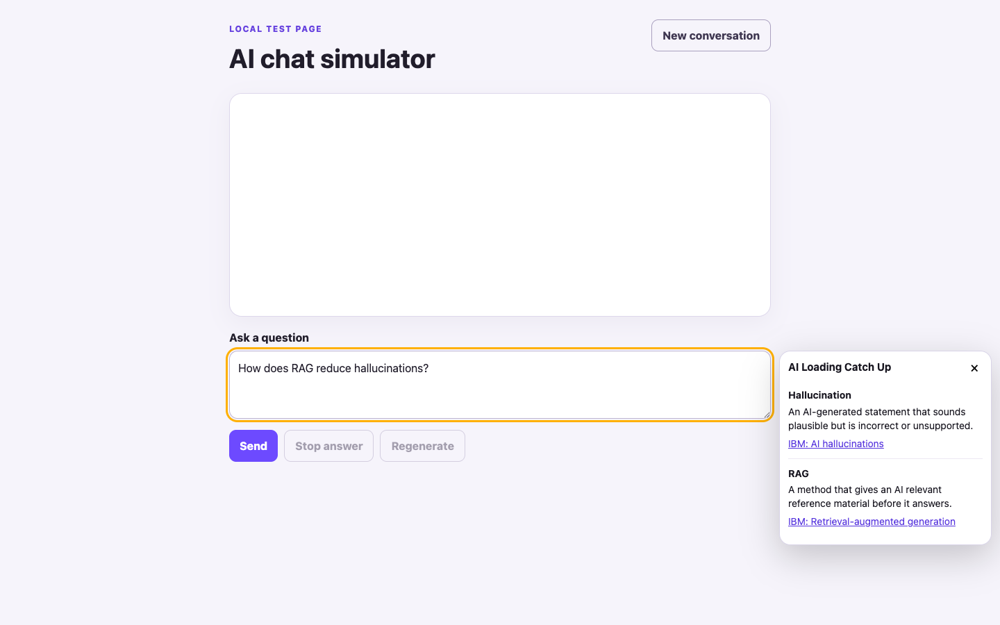

# AI Loading Catch Up

AI Loading Catch Up is a local Chrome extension that explains difficult concepts while the user waits for an AI-chat answer. Its open panel stays beside the composer for question concepts. After an answer stabilizes, it underlines up to five additional Tavily-backed concepts in the answer and shows a one-line explanation on hover or keyboard focus.





The extension analyzes a supported chat composer after a short pause while typing. Cached terms appear immediately, and complete unknown concepts can begin online resolution before the question is submitted when Online lookup is enabled.

Answer annotations appear only after the streamed text remains stable. The extension skips links, code, controls, and editable content when adding underlines. Tavily requests contain only candidate terms, domains, and short meaning hints; the transcript remains in the page.

## Requirements

- Node.js 22.14 or newer. Node 26 LTS is recommended when available.
- Desktop Chromium or Chrome for manual use.
- Tavily is optional. Offline glossary explanations require no account or key.

## Run locally

```sh
npm install
npm run dev
```

Open `http://127.0.0.1:4311`, then load `extension/` from `chrome://extensions` using **Load unpacked**. The local server is bound to `127.0.0.1` only.

The extension starts with online lookup disabled. Open its toolbar settings to enable it. For live lookup, copy `.env.example` to `.env`, set `TAVILY_API_KEY`, and export the value before starting the server. The server never sends the raw question or answer; it receives only a bounded term, domain, and short sense hint.

## Verify and package

```sh
npm run check
npm run package
```

`npm run check` runs Node logic/API checks and the installed extension in Playwright's bundled Chromium. Packaging copies the extension without compilation to `dist/ai-loading-catch-up-unpacked/` and creates `dist/ai-loading-catch-up-chrome.zip`.

## Project layout

- `extension/`: Manifest V3 extension, settings, content UI, glossary, and selection logic.
- `simulator/`: deterministic local chat and streaming-answer fixture.
- `backend/`: loopback HTTP API, SQLite cache/budget repository, and Tavily adapter.
- `tests/`: logic, backend, and persistent-browser extension checks.
- `docs/`: architecture, privacy, verification, and later-hosting notes.

## Current limits

- Composer adapters and representative layouts are covered for ChatGPT, Claude, and Microsoft Copilot. Their live sites can change independently and have not been verified in a signed-in browser session.
- English and desktop Chromium are the only supported targets.
- The backend has no public authentication because it only accepts loopback traffic. Do not expose it publicly.
- Node 22 prints an experimental SQLite warning. Node 26 is the intended long-term runtime.
- A real Tavily lookup was verified locally through the application backend. Automated tests continue to use deterministic provider doubles so routine checks do not consume credits.
